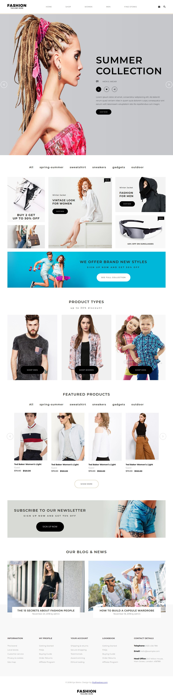
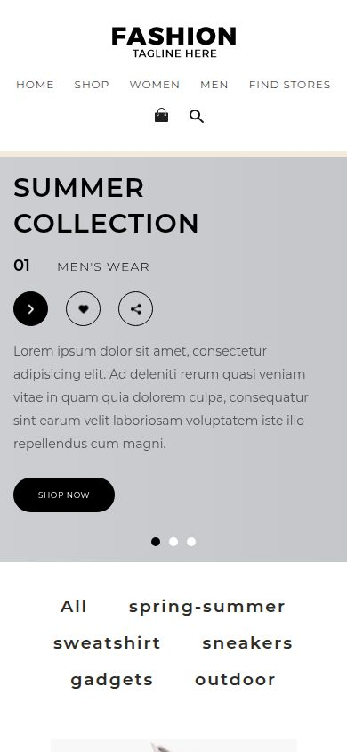

# Fashion — e-commerce home page

The home page of a fashion online store, built from a [Psdfreebies.com](https://psdfreebies.com/) PSD
template in November 2018. HTML, SCSS (BEM blocks) and two jQuery + Owl Carousel sliders.

## Screenshots

<table>
  <tr>
    <th>Desktop (1280 px)</th>
    <th>Phone (390 px)</th>
  </tr>
  <tr>
    <td valign="top"></td>
    <td valign="top"></td>
  </tr>
</table>

## What's on the page

- Header with the logo, menu, cart and an expanding search field
- Hero slider (Owl Carousel): arrows on desktop, dots on phones
- Category filter and a grid of offers
- Two promo banners and three product-type cards
- "Featured products" carousel: 4 / 3 / 2 / 1 cards depending on the width
- Blog cards, footer link columns and contacts

## Run it

The compiled `css/style.css` is committed, so you can just open `index.html` in a browser.

To work on the styles (Node 18+):

```bash
npm install
npm start        # compiles SCSS, watches it and opens a live-reloading server
npm run build    # compiles scss/ → css/style.css once
```

## Structure

```
.
├── index.html
├── scss/
│   ├── style.scss          # Imports everything below
│   ├── _reset.scss, _variables.scss, _mixins.scss, _core.scss
│   └── blocks/             # One file per BEM block: header, slider, offers, featured, blog…
├── css/
│   ├── style.css           # Compiled from scss/
│   └── owl.carousel.css
├── js/
│   ├── owl.carousel.js     # Owl Carousel 2.3.4
│   └── script.js           # Carousel setup and the search toggle
├── img/
└── docs/screenshots/       # Screenshots for this README
```

jQuery 3.7.1 is loaded from the official CDN with a Subresource Integrity hash.

## What it practices

- Turning a PSD design into a responsive page
- SCSS: variables, a `btn()` mixin with keyword arguments, one partial per BEM block
- Flexbox layouts with breakpoints at 1300, 1073, 980, 880, 768, 640, 580 and 480 px
- Configuring a carousel per screen width

## Notes

- Links and forms are placeholders; prices, product names and contacts are mock data.
- Design: [Psdfreebies.com](https://psdfreebies.com/). Photos come with the template.
- Originally built with Gulp 3, which no longer runs on current Node; the build is now plain
  `sass` + `browser-sync` npm scripts.

Made by [Ilya Bielov](https://www.facebook.com/MrBiela).
